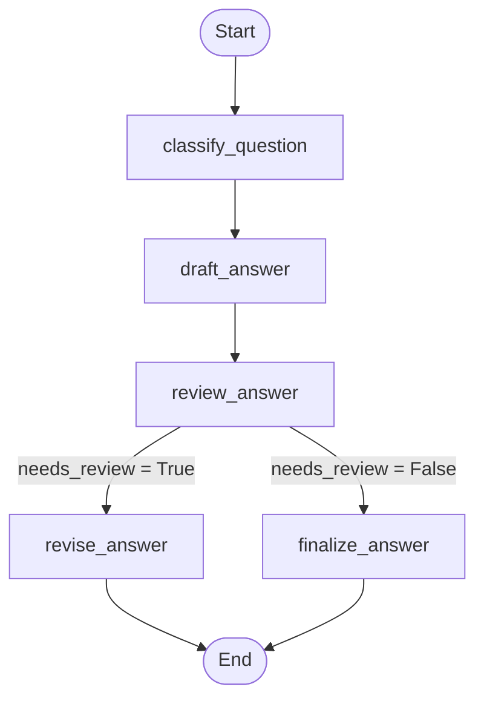

# Multi-Step Workflow in LangGraph — Diagram

## What this workflow does
Takes a question, classifies it, drafts an answer, reviews the draft, and either
revises it or finalizes it as-is, depending on the review outcome.

## State transitions

## Node descriptions

| Node | Purpose |
|---|---|
| `classify_question` | Labels the question as "factual" or "opinion" |
| `draft_answer` | Generates a first-pass answer from the LLM |
| `review_answer` | Asks the LLM to judge if the draft is complete and correct |
| `revise_answer` | Expands/improves the draft if the review flagged it as incomplete |
| `finalize_answer` | Passes the draft through unchanged if the review approved it |

## Why a conditional edge
The `review_answer` node doesn't always lead to the same next step — its output
(`needs_review`) decides whether the graph goes to `revise_answer` or
`finalize_answer`. This is done with `add_conditional_edges` and a routing function
(`route_after_review`), rather than a fixed edge, which is what makes this a
genuine multi-step *decision* workflow rather than a straight-line pipeline.

## How to view this rendered
Paste the mermaid block above into https://mermaid.live, or view this file directly
on GitHub, which renders mermaid diagrams natively in markdown files.
